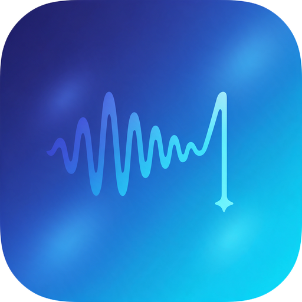

<p align="center">
  
</p>

<h1 align="center">LocalFlow</h1>

<p align="center">
  <b>Hold a key. Talk. Release. Your words appear — wherever your cursor is.</b><br>
  Private push-to-talk dictation for macOS. 100% on-device. No cloud, no account, no subscription.
</p>

<p align="center">
  
  
  
  
</p>

---

## What is it?

LocalFlow is a tiny menu bar app that turns your voice into text in **any app** — Slack, Notes, your editor, the browser, a terminal. You hold a shortcut, speak, and let go. A moment later the transcript is pasted right where you were typing.

Speech recognition runs **entirely on your Mac** using OpenAI's Whisper, compiled to CoreML and accelerated on the Apple Neural Engine through [WhisperKit](https://github.com/argmaxinc/WhisperKit). Your audio never leaves the machine. After the one-time model download, it works with Wi-Fi off.

## Features

- **Push-to-talk anywhere** — one global modifier key (Right ⌥ / Right ⌘ / Right ⌃ / Fn), configurable from the menu bar.
- **Private by design** — audio is processed locally and kept in memory only. Nothing is ever uploaded.
- **Fast on Apple silicon** — Whisper runs on the Neural Engine / GPU, not the cloud.
- **Choose your accuracy** — pick a model from the menu:

  | Model | Size | Best for |
  |-------|------|----------|
  | Fast — `base.en` | ~150 MB | Quick notes, low-end Macs |
  | Balanced — `small.en` | ~480 MB | Everyday dictation |
  | Best — `large-v3 turbo` | ~630 MB | Maximum accuracy (default) |

- **Automatic cleanup** — strips filler words ("um", "uh", "erm"), Whisper artifacts like `[BLANK_AUDIO]`, fixes spacing and capitalizes sentences.
- **Silence-safe** — filters the phantom "Thanks for watching!" Whisper tends to hallucinate on empty audio, and ignores accidental taps.
- **Clipboard-friendly** — pastes your text, then restores whatever was on your clipboard.
- **Unobtrusive UI** — a mic icon in the menu bar plus a small floating pill with a live waveform while you speak. It never steals focus.
- **Audio cues** — optional start/stop sounds.

## How it works

```
 hold key ──▶ record mic ──▶ Whisper (CoreML) ──▶ clean up text ──▶ paste at cursor
   │           16 kHz mono     on-device, ANE        fillers, caps       ⌘V, clipboard
   │           in memory                                                  restored
   └─ release key to stop
```

1. **Hotkey** — `HotkeyMonitor` watches a modifier key globally (`flagsChanged` events), so holding it types nothing.
2. **Record** — `AudioRecorder` captures the default mic with `AVAudioEngine` and converts it to the 16 kHz mono float samples Whisper expects, while streaming input levels to the waveform overlay.
3. **Transcribe** — `Transcriber` runs the selected Whisper model through WhisperKit. Models are downloaded once into `~/Library/Application Support/LocalFlow/models`.
4. **Clean** — `TextCleaner` applies light rule-based post-processing to the raw transcript.
5. **Insert** — `TextInserter` places the text on the pasteboard, synthesizes `⌘V` into the focused app, then restores your previous clipboard.

Everything lives in about 800 lines of Swift under `Sources/LocalFlow`.

## Install

**Requirements:** macOS 14 (Sonoma) or newer, Xcode Command Line Tools (Swift 5.10+). Apple silicon is recommended.

```bash
git clone https://github.com/Vikusmi/LocalFlow.git
cd LocalFlow
./build-app.sh
```

The script builds a release binary, wraps it into `LocalFlow.app`, ad-hoc signs it and installs it to `/Applications`. Then launch **LocalFlow** — it lives in the menu bar (no Dock icon).

> `build-app.sh` also includes a workaround for broken Command Line Tools installs that fail with `import Foundation` errors. It builds against a VFS overlay and modifies nothing on your system.

### First launch

1. **Microphone** — allow access when prompted.
2. **Accessibility** — grant it in *System Settings → Privacy & Security → Accessibility*. LocalFlow needs this to listen for the global shortcut and to paste into other apps. Without it, the text is still copied to your clipboard so you can press ⌘V yourself.
3. **Model download** — the first run downloads and prepares the model (a few minutes for the larger ones). The menu bar shows progress. After that, startup is quick and fully offline.

## Usage

| Action | What to do |
|--------|-----------|
| Dictate | Hold **Right Option ⌥** (default), speak, release |
| Change shortcut | Menu bar icon → **Shortcut** |
| Change model | Menu bar icon → **Model** |
| Toggle sounds | Menu bar icon → **Sounds** |

The menu bar icon shows state: `mic` ready · red `mic.fill` listening · `…` transcribing · download arrow while loading.

## Project layout

```
Sources/LocalFlow/
├── main.swift           app entry point
├── AppDelegate.swift    menu bar UI and the record → transcribe → insert flow
├── HotkeyMonitor.swift  global push-to-talk key handling
├── AudioRecorder.swift  mic capture → 16 kHz mono samples
├── Transcriber.swift    WhisperKit model download, load and inference
├── TextProcessing.swift transcript cleanup + paste-at-cursor
├── Overlay.swift        floating waveform pill (SwiftUI)
└── Settings.swift       persisted shortcut / model / sounds
```

## Privacy

- Audio is held in memory only while you record and is discarded after transcription.
- No network calls except the one-time model download from Hugging Face.
- A troubleshooting log is written locally to `~/Library/Logs/LocalFlow.log`. It includes the transcribed text, so delete it if you dictate anything sensitive.

## Limitations

- English only for now (the bundled model variants and decoding options are set to English).
- Pastes via ⌘V, so the target app needs to accept pasted text.

## Built with

[WhisperKit](https://github.com/argmaxinc/WhisperKit) · [OpenAI Whisper](https://github.com/openai/whisper) · Swift, AppKit, SwiftUI, AVFoundation

---

<p align="center"><sub>Made by <a href="https://github.com/Vikusmi">@Vikusmi</a></sub></p>
